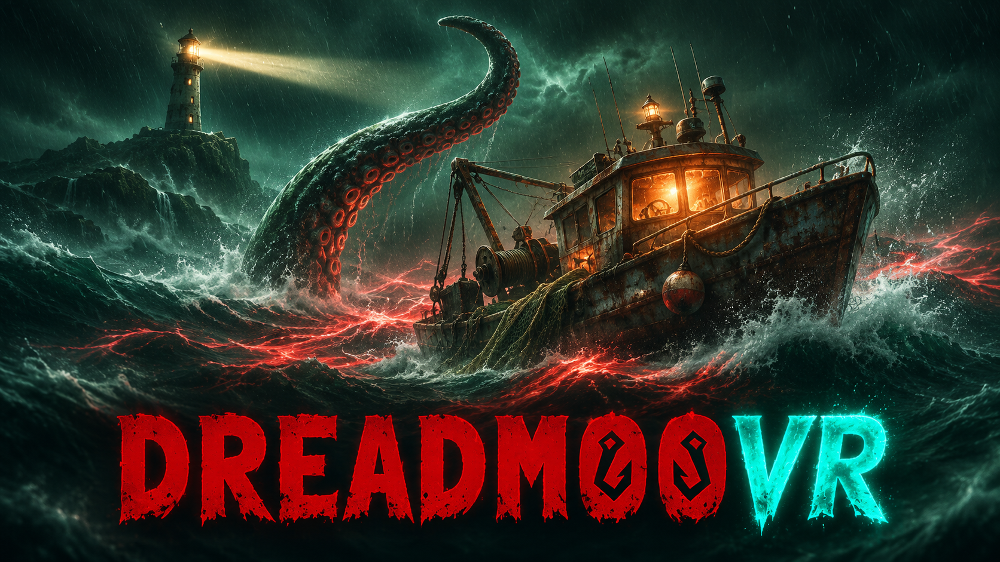

# DreadmoorVR

### A deep-sea survival game, rebuilt for room-scale VR.

**Developer & ethical hacker · VR systems · Authorized reverse engineering · Input engineering**

[Project status](docs/testing/v1-readiness.md) · [Install notes](docs/release/INSTALL.md) · [Changelog](CHANGELOG.md) · [Research notebook](docs/research)

I’m building a full-body VR mod for **Dreadmoor** on **UE 5.6** and **Steam Frame**. It connects tracked hands and headset motion to the game’s existing systems: grappling, melee guard, fishing, crafting, and boat controls. The work spans native input, Lua runtime hooks, Unreal assets, and reverse engineering the shipped game code.

> **Current state:** private beta candidate. Local smoke checks are in place; fishing, boat handling, and the target Steam Frame setup still need final headset acceptance. See [v1 readiness](docs/testing/v1-readiness.md) for evidence and open gates.

## What’s in the build

| VR feature | What it does |
|---|---|
| **Tracked arms and held tools** | Fits the in-game arms to tracked poses and aligns held equipment to the hand. |
| **Gesture combat** | Adds a physical melee guard and hand-directed grappling interactions. |
| **Fishing and crafting** | Maps tracked-hand motion to fish-fight, reel, QTE, and crafting cursor actions. |
| **First-person boat controls** | Steers from the left hand and uses right-hand throttle detents with haptic feedback. |
| **Input bridge** | Connects SteamVR controller actions to the game while preserving native third-person boat input. |

## Engineering behind it

This project is a practical systems integration across several layers:

- **UEVR Lua bridge** — pose-driven gestures, runtime checks, and safe recovery when tracking drops.
- **Native C++ / OpenVR plugin** — controller input support and action bindings for Steam Frame.
- **Unreal Engine 5.6** — custom VR arm assets, cooked into a small allowlisted pak.
- **Local reverse-engineering toolkit** — Python parsers for Unreal IoStore containers, Blueprint bytecode, and input mappings; evidence is recorded in [`docs/research`](docs/research).
- **Regression harnesses** — Lua and native tests cover gesture logic, input ownership, and failure recovery.

### A security-minded reverse-engineering workflow

I use reverse engineering as a scoped engineering practice: establish authorization and scope, inspect local game assets and runtime behavior, validate hypotheses against the actual project, then document what is known and what still needs a headset check. The parsers and notes turn opaque game behavior into reviewable evidence instead of relying on guesses. This work focuses on VR mod compatibility and game interaction, with clear separation between verified behavior and open questions.

**Toolchain:** C++ · Lua · Python · Unreal Engine 5.6 · UEVR · OpenVR · SteamVR · EngineWire Unreal MCP · Git

## Build and release discipline

The mod has a repeatable cook/deploy path, a packaged beta workflow, rollback instructions, and an asset allowlist. The project keeps implementation status separate from headset acceptance so a green desktop harness is never presented as proof of an in-headset result.

- [v1 readiness and remaining validation](docs/testing/v1-readiness.md)
- [Gesture smoke-test checklist](docs/testing/m3-gesture-checklist.md)
- [Install, update, and rollback](docs/release/INSTALL.md)
- [User-visible changes](CHANGELOG.md)

## Developer note

I built this with UE 5.6, UEVR’s Lua bridge, a small native OpenVR input plugin, SteamVR action bindings, EngineWire’s Unreal MCP, and local parsers for cooked IoStore containers and Blueprint bytecode. AI helped trace and cross-check shipped-game calls and Unreal APIs; I verified the findings against the project and runtime, then did the headset tuning. I can read C++; I just can’t read a whole game’s worth of Blueprint bytecode by hand before breakfast.

**DreadmoorVR · built by [@f4mrfaux](https://github.com/f4mrfaux)**

